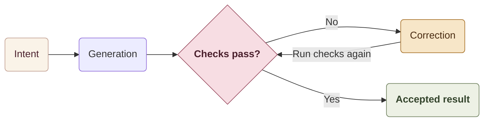

Last year, with [**Vibe Reviewing**](/blog/2025-09-08-exit-vibe-coding--enter-vibe-reviewing/), I was mainly interested in another side of AI in software development: its ability to audit existing code, uncover technical debt, and surface inconsistencies and risks.

A year later, the way we use agents has evolved.

We are starting to delegate complete tasks to agents capable of exploring a codebase, changing multiple files, running tests, realizing they got something wrong, and trying again.

After auditing the codebase, we wanted to put them to work modernizing it. Those experiments led me to this observation:

> **The more probabilistic code production becomes, the more deterministic the environment around it needs to be.**

I call this **Deterministic Engineering**.

Agent autonomy depends on the quality of both the model and the engineering system around it. That system needs to leave as little as possible for the agent to guess.

The idea overlaps with **Harness Engineering**, but what I am observing goes beyond the tooling surrounding the agent.

Our experiments at Carrefour focus on the codebase, feedback loops, and team organization: what needs to change so we can delegate more to agents.

## Shaping the agents' environment

LLMs can produce different answers to the same request. We can constrain that variability through codebase rules, architecture, and checks that determine whether the result is acceptable.

An agent may propose ten plausible implementations of the same feature.

That is not much of a problem if nine of them are immediately rejected.

Part of the model's non-determinism is then absorbed by the system.

> **Reduce the space of acceptable solutions enough that different producers — humans or agents — converge toward broadly similar solutions from the same intent.**

Implementations may vary. They must follow the same conventions and meet the same acceptance criteria.

  <figure class="img-figure">
    
    <figcaption class="img-caption">One direction. A deterministic path.</figcaption>
  </figure>

### A simple example

Ask two different agents to add the same API call.

In a permissive codebase, one might create its own HTTP client while the other reuses an existing abstraction.

One returns `null` on error and adds a retry mechanism; the other throws an exception without retrying.

Both solutions may work, while each introduces another variation into the system.

In a more deterministic environment, the HTTP client already exists, the error-handling mechanism is defined, allowed dependencies are controlled, and tests describe the expected behavior.

The implementations may still differ, but they rely on the same architecture. **That convergence is what interests me.**

## From Harness Engineering to Deterministic Engineering

**Harness Engineering** builds the means for an agent to work: context, tools, tests, end-to-end checks, observability, and feedback loops. It lets the agent explore the codebase, make changes, and evaluate the result.

But a well-equipped agent can still get lost in the system it needs to modify.

Several generations of architecture coexist, errors are handled in different ways, and conventions change from one folder to another. The same frontend uses several design systems. Some business rules are still passed on by word of mouth.

The harness lets it explore all these paths. It still has to guess which ones to follow.

  <figure class="img-figure">
    
    <figcaption class="img-caption">An agent lost in legacy.</figcaption>
  </figure>

This is where I place **Deterministic Engineering**: reducing ambiguity in the system itself. Define the abstractions to reuse, the allowed dependencies, and the conventions to follow, then make those rules automatically verifiable.

**Harness Engineering gives the agent the means to act. Deterministic Engineering reduces the number of wrong directions it can take.**

An experienced developer knows the old folders, abandoned patterns, and poorly documented exceptions.

The agent has to do archaeology.

And every unnecessary alternative increases the chances that it chooses the wrong one.

**Code quality directly affects your agents' performance.**

## An autonomous agent needs to know when it is wrong

Beyond prompts and skills, we need to give the agent the means to check its work. How can it know that it has finished and that the result is correct?

It needs to be able to repeat this loop:

Tests, types, CI, and architecture checks need to return errors quickly, in a form the agent can understand and fix.

The more an agent can verify its own work without waiting for a human, the more this loop can run on its own.

  <figure class="img-figure">
    
    <figcaption class="img-caption">The feedback loop.</figcaption>
  </figure>

## Agents change the economics of quality

Refactoring, standardizing, breaking code into smaller pieces, adding tests, and maintaining a consistent structure all take time. As a deadline approaches, those tasks often get postponed:

> “We'll do it later.”

In practice, they pile up in the backlog.

Agents reduce the work required for some of these changes. That lets us raise standards we previously struggled to maintain for lack of time.

Those requirements need to serve a quality goal. Adding constraints to force teams to use AI would mostly make their work more painful.

On a legacy codebase, *chabudai gaeshi* — flipping the table to start over — remains a last resort. Yet some projects become so bogged down in technical debt that a substantial rebuild becomes necessary. This has happened to us. In that situation, the legacy codebase remains our knowledge base.

Advances in the latest frontier models can now make such a rebuild less costly. We then need to assess what can still evolve incrementally and what deserves to be rebuilt.

  <figure class="img-figure">
    
    <figcaption class="img-caption">Chabudai gaeshi.</figcaption>
  </figure>

Incremental progress remains our default approach: prevent new regressions, then gradually raise the expected standard.

Every improvement becomes the new minimum acceptable standard. When a rebuild is necessary, it should follow these rules and checks from the outset.

In both cases, the goal is to reduce debt while preventing its reintroduction.

## Supporting changes in roles and teams

Delegating more to agents means the whole team — developers, tech leads, product managers, designers, and Quality Assurance — needs to rethink how it defines needs, designs solutions, verifies results, and distributes responsibilities.

When agents produce code quickly, more of our work as engineers goes into framing the problem, checking the architecture, and spotting questionable abstractions.

With **Agentic Development**, engineering work extends to the system that produces the code. We also need to design its rules, checks, and validation mechanisms.

Human involvement belongs throughout the work, depending on the task and its risks.

An architectural change or an ambiguous business rule often calls for discussing the plan before implementation starts: clarifying the need, examining the options, and weighing trade-offs. Waiting until review to discover a disagreement about the approach means redoing work that has already been completed and wasting tokens.

For a well-defined task, the agent can work more independently, with appropriate checks.

The final review allows for adjustments, checks for regressions and whether the change meets the need, and resolves the remaining trade-offs. It can open up a discussion, but it should not be where all the thinking happens.

If the human only steps in to click “approve” after 800 generated lines, code review starts to resemble a CAPTCHA for developers. After enough clicks just to keep things moving, you start to wonder whether a trained pigeon could do just as well.

  <figure class="img-figure">
    
    <figcaption class="img-caption">Human judgment.</figcaption>
  </figure>

A team already comfortable with agents and a skeptical team need different support: time, training, and experimentation. Without that buy-in, the tools may see little use despite the work on the architecture.

## There is no universal method for agentic transformation

We are seeing “a day in the life of the agentic developer,” target workflows, and platforms that supposedly explain how teams should now work.

The developer picks up a requirement, delegates to an agent, supervises, reviews, and merges.

A few arrows, two loops, and everyone is transformed before lunch.

These journeys often assume that teams face the same difficulties.

One team loses time because requirements are poorly understood. Another because reviews take two days. A third because tests are too slow.

Elsewhere, the problem may be CI, technical debt, the release process, or simply the team's maturity with these tools.

Imposing the same journey on everyone means optimizing a problem that some teams do not even have.

To choose a workflow, I would start with the team's actual problem:

> **“Where is this team's bottleneck, on this project, today?”**

The answer might call for a development agent, help with reviews or incident analysis, better documentation, test generation and automation, or work on how requirements are expressed.

An agentic platform becomes useful when each team can assemble its capabilities to fit its needs. Some invariants are shared — interfaces, rules, acceptance criteria — while ways of working remain adapted to each team’s context.

## What a platform enables, and what remains to be done

A shared platform makes skills, agents, prompts, workflows, MCPs, and who knows what else easier to access. Teams still need to decide how to evolve the architecture, address technical debt, and distribute responsibilities.

Some bottlenecks extend beyond the scope of a single team.

If the CI platform is already struggling with the load, adding more agents that submit code may simply lengthen the queue. If every change depends on several teams or a centralized approval, that coordination also needs to change. A shared platform should help address these difficulties: provide the missing capabilities and enable teams to move forward without shifting the overload to the next stage.

And sometimes, **we are the legacy**.

Agents' mistakes expose ambiguities that developers had learned to work around.

The “turnkey transformation” sold as a repository to clone leaves every difficult decision to the project team. Your problems are still there. They now have fifty tools to keep them company.

## Measuring the team's progress

The percentage of AI-generated code tells us how much we delegate. It says little about the quality of the result and can rise alongside technical debt.

An agent can generate 100% of a bad codebase.

Congratulations, you automated the problem.

The same applies to the number of skills, agents, “agentified” stages, or “AI readiness” scores.

Soon, every project will get an **A** for “AI maturity”: twenty skills, three agents, a workflow, and an MCP for dessert… and who knows what else. Whether the team understands what is going on is not part of the grading criteria.

I explored this trap in [When measuring a coding assistant ends up breaking it](https://heristop.github.io/blog/2026-06-03-when-measuring-a-code-assistant-breaks-it/): when token consumption becomes a productivity target, teams have an incentive to inflate usage, without necessarily improving the code. The same risk applies to agentic transformation scores.

> **Which bottleneck did we reduce, and what measurable impact did that have?**

Cycle time, review time, human rework, autonomy on a specific type of task, production incidents: the right metrics depend on the problem we are trying to solve.

> **Is this team delivering more business value, faster and more reliably than before?**

If the answer is no, your agents can talk to each other and even commit code while you sleep. By morning, the token bill will be the only measurable result.

## What I take away from our experiments

Four practical levers emerge:

- **Reduce implicit choices**: specify which abstractions to reuse, which conventions to follow, and which dependencies are allowed.
- **Make the rules verifiable**: give agents tests, type checks, and automated checks to detect and correct their mistakes.
- **Gradually raise the minimum acceptable standard**: prevent new regressions, then bring legacy code up to that standard.
- **Remove bottlenecks shared by teams**: adapt tools, platforms, and the organization when several teams run into the same limits.

How these principles are applied depends on each team’s difficulties and the bottlenecks that need to be addressed across the organization.
